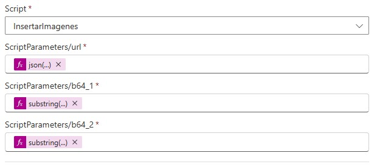

## When a new response is submitted

Here you set the form the image is linked to.

## Get response details

Here you enter the Form Id and the Response Id.

## Add a row into a table

Enter the path where the file generated by the form is located, and also select the table. Then, under advanced parameters, add every column you want to display. In the image column, enter the following:

**"json(outputs('Get_response_details')?['body/r5dd8fef347ff48f5bf4a7048eb107d98'])[0]?['link']"**

**Be careful with the line "body/r5dd8fef347ff48f5bf4a7048eb107d98", because it refers to the internal identifier of the column stored in Google Forms. You have to look it up and change it.**

## Delay

Set it to a recommended time of 5 to 10 seconds.

## Get file content using path

Enter the following expression: "decodeUriComponent(split(json(outputs('Get_response_details')?['body/r5dd8fef347ff48f5bf4a7048eb107d98'])[0]?['link'], '/Documents/')[1])"

**Change both the body path and /Documents/ to the ones that apply to you.**

## Run script

Add the script and make sure it comes out as shown below:

* **ScriptParameters/url** enter the following: "json(outputs('Get_response_details')?['body/r5dd8fef347ff48f5bf4a7048eb107d98'])[0]?['link']" **remember to change the body to the one that belongs to you**

* **ScriptParameters/b64_1** enter the following: "substring(base64(outputs('Get_file_content_using_path')?['body']), 0, 3500000)"

* **ScriptParameters/b64_2** enter the following: "substring(base64(outputs('Get_file_content_using_path')?['body']), 3500000)"
