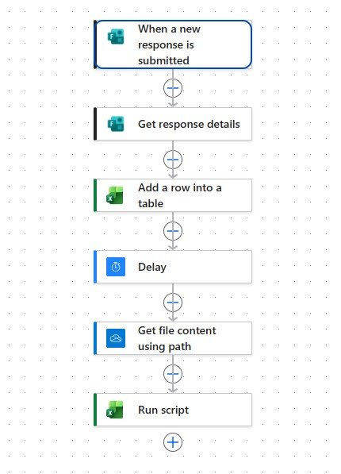

# (Ocupational Health and Safety (OHS) or SST in spanish) Photo Record Automation

Automation tool for logging work-at-height permits. It captures data and photos from Microsoft Forms and consolidates them automatically into an Excel file by inserting the images directly into the cells (no links left behind).

## Main Features
*   **100% Microsoft Ecosystem:** Works with Forms, Power Automate, Excel Online, and Office Scripts.
*   **No Extra Costs:** Uses standard connectors and base Microsoft 365 licenses.
*   **Excel Timeout Fix:** Implements the *Chunking* technique (splitting the Base64 data) to process heavy photos (6 MB+) without the flow crashing.
*   **Automatic Cleanup:** Replaces the SharePoint link generated by Forms with the image embedded in the cell.

## Solution Architecture
1.  **Microsoft Forms:** Collects the data and the photos.
2.  **Power Automate:** Receives the response, saves the row in Excel, downloads the photo, splits it, and sends it.
3.  **Office Scripts:** Receives the link and the Base64 image, locates the cell, deletes the link, and inserts the image fitted to the cell size.

## Requirements
*   Microsoft 365 account (Business or Education).
*   Access to Microsoft Forms, Power Automate, and Excel Online.

## Installation and Setup Guide

1. First, create the form in Microsoft Forms. Once the linked Excel workbook is generated, unlink it and create another workbook with the same structure. **(When you unlink the workbook, Forms generates a new one, so you can keep using the original workbook without having to create a new table linked to the form.)**

2. Open the Automate tab and create a new script for the current worksheet and table. Paste in the code located here [Scripts](./Scripts/). and adjust it if necessary.

3. Next, go to Power Automate and set up the following flow: 

For more details, see the [Power_automate](./Power_automate/) folder. 

4. That’s it! From now on, each form submission will automatically trigger and complete the workflow.

## Troubleshooting
*   **Timeout Error:** Explain the Chunking trick.
*   **Duplicate records issue:** Explain why the Excel file must be unlinked from Forms so that only Power Automate writes to it.

## License
This project is licensed under the MIT License.